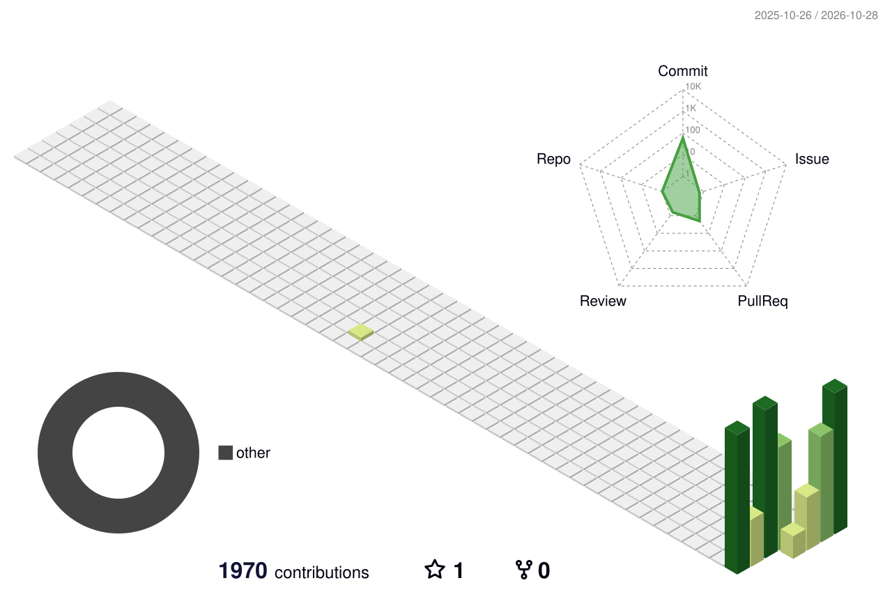

<!-- ============================================================
     PROFILE README for Anthony Hable (sun-of-anton)
     Lives in the public repo sun-of-anton/sun-of-anton
     ============================================================ -->

<!-- Matrix rain intro (assets/matrix-intro.svg) loops through scenes; clicking opens the interactive version (docs/index.html on GitHub Pages) -->
<a href="https://sun-of-anton.github.io/sun-of-anton/?v=4"></a>

<p align="center">
  <a href="https://sun-of-anton.github.io/sun-of-anton/?v=4"></a>
  <a href="#-right-now"></a>
</p>

<p align="center">
  
</p>

<!-- Images inside <picture> are not auto-linked by GitHub, so these badges stay unclickable -->
<p align="center">
  <a href="https://www.linkedin.com/in/ashable/"></a>
  <picture></picture>
  <picture></picture>
  <picture></picture>
  <picture></picture>
</p>

---

### 🧭 Right now

| | |
|---|---|
| 🏗️ **Building** | Agentic AI systems for software development intelligence, autonomous agile product management and operational decision support |
| ☁️ **Architecting** | AWS infrastructure and enterprise apps for restricted environments — limited connectivity, local execution, strict auth |
| 🤖 **Exploring** | How AI-assisted engineering changes the way teams design, debug and deliver software |
| 💬 **Ask me about** | AWS GovCloud · serverless ETL · Infrastructure-as-Code · Python automation · agile product ownership |
| 📍 **Based in** | Hampton Roads, Virginia · open to collaborating remotely |
| ⌨️ **Coding since** | 2015 · on GitHub since 2026 — late to git, not to code |

---

### 🛠️ Tools I reach for

<p align="center">
  <picture></picture>
</p>

<p align="center">
  <picture></picture>
  <picture></picture>
  <picture></picture>
  <picture></picture>
  <picture></picture>
  <picture></picture>
  <picture></picture>
  <picture></picture>
</p>

---

### 🏆 Highlights

<table>
<tr>
<td width="50%" valign="top">

#### ☁️ GovCloud data platform
Sole AWS-certified engineer on the team, owning architecture, security and automation end to end for an IL5 enterprise data platform.
Event-driven ETL on **Lambda · Step Functions · Glue · S3 · PostgreSQL**, locked down with least-privilege IAM, KMS and Secrets Manager.

</td>
<td width="50%" valign="top">

#### ⚙️ Automation over toil
Thousands of lines of Python and reusable IaC frameworks replacing manual deployment workflows.
Earlier: SharePoint and Power Automate workflows that lifted engineering team efficiency **30%**.

</td>
</tr>
<tr>
<td width="50%" valign="top">

#### 🚀 Aerospace & defense roots
Telemetry analysis and test systems at Northrop Grumman that helped deliver a major program **3 months early**.
Miniaturized satellite data unit components at L3 — **25%** smaller and lighter.

</td>
<td width="50%" valign="top">

#### 📊 Workforce intelligence
Built a knowledge-gap analysis tool with competency data and spider-graph visuals at Boeing — **15%** team performance gain, **50%** faster new-engineer ramp-up.

</td>
</tr>
</table>

---

### 🎓 Certifications

<p align="center">
  <picture></picture>
  <picture></picture>
  <picture></picture>
</p>

<p align="center">
  <picture></picture>
  <picture></picture>
  <picture></picture>
  <picture></picture>
  <picture></picture>
</p>

---

### 🚀 Featured repos

<p align="center"><i>🚧 Coming soon — public projects are on the way.</i></p>

---

### 🧬 The path here (a non-linear speedrun)

> Most people pick a lane. I tried about nine of them first.

```text
2004 ─ 💣 Navy EOD Technician ──────── defused bombs. peaked early?
2011 ─ 🏥 Veterans Health Admin ────── discovered SharePoint. it discovered me back.
2013 ─ 🛣️  AECOM ───────────────────── roads, drainage, then fire sprinklers at West Point
2015 ─ 🛰️  L3 / TECOMSYS ───────────── made satellite parts 25% smaller. also antennas. same time.
2018 ─ ✈️  Boeing ──────────────────── designed airplane parts, secretly automated everyone's job
2020 ─ 🚀 Northrop Grumman ─────────── first "Software Engineer" title. the plot thickens.
2023 ─ 🎓 Velocity Consulting ──────── taught Boeing a new CAD platform, made AI do the voiceovers
2024 ─ 🔌 HII ─────────────────────── stood up an air-gapped server. it did not have Wi-Fi. on purpose.
2025 ─ ☁️  CACI ────────────────────── finally put it all in the cloud (GovCloud, IL5)
2026 ─ 🤖 Norfolk Naval Shipyard ───── AWS architect building agentic AI  ◀ found the groove
```

<sub>Turns out every detour was a side quest. Bombs taught precision, aerospace taught testing, SharePoint taught me that every manual process is a script waiting to happen.</sub>

---

### 📈 By the numbers

<p align="center"><i>🚧 Coming soon.</i></p>

---

### 📝 Latest activity

<!--START_SECTION:activity-->
<!--END_SECTION:activity-->

---

### 🏙️ Contributions, in 3D

<!-- Generated daily by .github/workflows/profile-3d.yml -->
<picture>
  <source media="(prefers-color-scheme: dark)" srcset="./profile-3d-contrib/profile-night-rainbow.svg"/>
  
</picture>

### 🐍 Contributions, eaten

<picture>
  <source media="(prefers-color-scheme: dark)" srcset="https://raw.githubusercontent.com/sun-of-anton/sun-of-anton/output/snake-dark.svg"/>
  
</picture>

---

<details>
<summary><b>🎖️ How I work (click to expand)</b></summary>
<br/>

- **Constraints are design inputs.** Air-gapped servers, approved-tech lists and no internet aren't blockers — they're the spec.
- **Automate the second time.** If I do something manually twice, the third time is a script.
- **Own it end to end.** Roadmap, backlog, architecture, docs — I've often been the only one holding all of it.
- **Discipline from the Navy.** Precision, checklists and calm under pressure carried straight into engineering.

</details>

<picture></picture>
